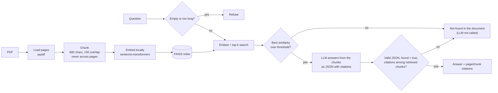

# RAG Assistant (local FAISS + citations)

Ask questions about a PDF. Answers come with citations (page and chunk), and when the document does not contain the
answer the assistant says **"not found in the document"** instead of inventing one. The refusal is enforced in code
(a similarity threshold, citation checks), not only in the prompt.

## Data: what is public and what is synthetic
- **Public document (not in this repo):** NIST AI Risk Management Framework 1.0 (NIST AI 100-1), downloaded on demand by
  `scripts/download_pdf.py` from <https://nvlpubs.nist.gov/nistpubs/ai/NIST.AI.100-1.pdf>. The file is git-ignored.
  - **Credit:** NIST AI 100-1, *Artificial Intelligence Risk Management Framework (AI RMF 1.0)*, National Institute of Standards and Technology. <https://www.nist.gov/itl/ai-risk-management-framework>
  - **Licence note:** NIST states that works by its own employees are not subject to copyright in the United States (17 U.S.C. §105) and asks for credit. That applies to US works and may not hold elsewhere. Check NIST's own copyright notice before reusing the document.
- **Synthetic (in this repo):** `data/sample/synthetic_handbook.pdf`, a fictional 3-page staff handbook generated by code
  (`src/rag_assistant/synthetic.py`). The tests and the `--mock` evaluation use only this file and fake components.
- The question sets in `eval/` were written by the author; the NIST questions have expected keywords and page numbers
  taken from the PDF.

## Architecture


## Tech
Python 3.11, pypdf, sentence-transformers (local embeddings, default `all-MiniLM-L6-v2`), FAISS (`faiss-cpu`), OpenAI SDK
(any OpenAI-compatible endpoint, or Azure OpenAI), pytest, Docker.

## How to run
```powershell
python -m venv .venv
.venv\Scripts\pip install -r requirements.txt      # large: PyTorch is installed with sentence-transformers
python scripts\download_pdf.py                      # fetches the NIST PDF into data\sample\ (git-ignored)
copy .env.example .env                              # fill in your own values; .env is git-ignored
```
Load your environment variables, then:
```powershell
$env:PYTHONPATH = "src"
python -m rag_assistant "What are the four functions of the AI RMF Core?"
python -m rag_assistant                              # interactive prompt
python -m rag_assistant --pdf data\sample\synthetic_handbook.pdf "How many sick leave days are there?"
```
The first real run downloads the embedding model (about 90 MB) from Hugging Face; after that it runs offline.

| Purpose | Variables |
|---|---|
| OpenAI-compatible endpoint | `OPENAI_API_KEY`, `OPENAI_BASE_URL`, `OPENAI_MODEL` |
| Azure OpenAI, key mode | `AZURE_OPENAI_ENDPOINT`, `AZURE_OPENAI_API_KEY`, `AZURE_OPENAI_DEPLOYMENT`, `AZURE_OPENAI_API_VERSION` |
| Azure OpenAI, sign-in mode (key not set) | the same endpoint/deployment/version, plus `AZURE_TENANT_ID`, `AZURE_CLIENT_ID`, `AZURE_CLIENT_SECRET` |
| Optional tuning | `SIMILARITY_THRESHOLD` (0.35), `TOP_K` (4), `CHUNK_SIZE` (800), `CHUNK_OVERLAP` (150), `EMBED_MODEL`, `LLM_TIMEOUT_SECONDS` (60), `MAX_FILE_MB` (50), `MAX_QUESTION_CHARS` (1000) |

If Azure variables are set, Azure is used; otherwise the OpenAI-compatible variables. A missing variable gives a clear
message, not a crash.

### Tests (no key, no downloads)
```powershell
python -m pytest -q
```
Tests use a fake LLM and fake (hashing) embeddings and a synthetic PDF generated on the fly.

### Evaluation
```powershell
python -m rag_assistant.evaluate --mock            # plumbing check: fake embeddings + fake LLM + synthetic PDF
python -m rag_assistant.evaluate --live --delay 13 --out docs\eval_live.json
```
`--mock` prints "NOT accuracy" and its numbers must not be quoted as results. `--live` uses local embeddings, the real LLM
from environment variables and the NIST PDF; `--delay SECONDS` pauses between questions for free-tier rate limits (the
client also waits and retries on HTTP 429, up to 6 times). Progress ("3/16 done") goes to stderr; `--out` saves the
summary plus per-question details (answer, citations, similarity, reason).

## Design choices
- **"Not found" is enforced in code, in layers.**
  1. Empty or over-long questions are refused before any search.
  2. If the best FAISS similarity is below `SIMILARITY_THRESHOLD`, the answer is "not found in the document" and the LLM is never called.
  3. The LLM must return JSON `{found, answer, citations}`. `found: false`, an empty answer, no citations, or a citation to a chunk that was not retrieved are all rejected (one retry with the error fed back, then "not found").
  4. LLM errors (timeout, exhausted rate limit) become a clear failure message, never an invented answer.
- **A threshold alone is not enough** (see the retrieval check below), which is why the LLM's `found` flag and the citation check exist as further layers. The threshold mainly cuts cost and catches clearly off-topic questions.
- **Citations are exact.** A chunk never crosses a page. Pages are PDF page numbers (the first PDF page is 1), which can differ from the page numbers printed on the document.
- **Local embeddings and FAISS:** no key or quota is needed for retrieval; only answering uses the LLM.
- **Swappable LLM:** OpenAI-compatible or Azure OpenAI (key or sign-in) through environment variables only; no secret is read from a file.

## Results
**Live run:** local embeddings (`all-MiniLM-L6-v2`), LLM `gemini-3.1-flash-lite` via an OpenAI-compatible endpoint, the NIST AI 100-1 PDF
(180 chunks), similarity threshold 0.35, top-k 4, on the 16 questions in `eval/questions_nist.json` (11 answerable, 5 not in the document).
**These numbers apply to this document and this question set only.** The questions and expected keywords/pages were written by the
author and correctness is a keyword check, so treat them as a small sanity check, not a benchmark. Raw output: `docs/eval_live.json`.

| Measure | Result |
|---|---|
| Overall accuracy (correct answers + correct refusals) | 0.8125 (13 of 16) |
| Answerable questions answered correctly (expected keywords present) | 8/11 |
| Citation on an expected page | 8/11 |
| False refusals (answerable, but the assistant said "not found") | 3 |
| Wrong answers (answered, but expected keywords missing) | 0 |
| Questions not in the document correctly refused | 5/5 |
| Questions not in the document wrongly answered | 0 |
| LLM or retrieval errors | 0 |

**The 3 false refusals.** All three passed the similarity threshold and were refused by the LLM (`reason: llm_said_not_found`), so
the code-level threshold did not block them. The run saved no retrieved chunks for refused questions, so the reasons below come from two sources:

| Question | Best similarity (from the run) | What the data shows |
|---|---|---|
| n08: "What does GOVERN 1.6 say?" | 0.36 (just over the 0.35 threshold) | A short, label-style question with a low similarity. In the earlier retrieval-only check the expected page (28) was among the top 4 chunks, but not the best one. Why the LLM said "not found" is not recorded. |
| n10: "What should happen if an AI system presents unacceptable negative risk?" | 0.74 | The similarity was high but the expected page (13) was **not** in the top 4 in the earlier retrieval-only check (pages 9 and 12 ranked higher), so the answer text was probably not among the chunks sent to the LLM. Not confirmed by the run file. |
| n11: "At which lifecycle stage should risk management efforts ideally start?" | 0.64 | Same pattern: the expected pages (5, 15) were **not** in the top 4 in the retrieval-only check. Not confirmed by the run file. |

In short: no wrong answer was produced and no unanswerable question was answered, but 3 of 11 answerable questions were refused,
and for two of them retrieval, not the LLM, is the likely weak point. Nothing was tuned after seeing these results, and the run was not repeated.

**Retrieval-only check (no LLM, measured before the live run):** with the real local embedding model on the NIST PDF (180 chunks),
the author-labelled expected page was among the top 4 retrieved chunks for 9 of 11 answerable questions (top 8: 10 of 11).
For the 5 questions that are not in the document, the best similarity was 0.30, 0.11, 0.36, 0.39 and 0.61, while
answerable questions scored between 0.36 and 0.77. So at the default threshold of 0.35 the gate removes only the clearly
off-topic questions; topical-but-absent ones (for example "which programming language should be used") pass the gate and
depend on the LLM's `found: false`. The threshold has not been tuned, to avoid fitting it to this 16-question set.

## Limitations
- Scanned or image-only PDFs have no text layer and are rejected with a clear message; OCR is not supported here.
- Encrypted PDFs, files over `MAX_FILE_MB` and very long questions are rejected, not truncated.
- Tables, figures and multi-column layouts are read as plain text by pypdf and may be garbled.
- The similarity threshold is a blunt gate (see above); questions close to the document's topic but not answered in it rely on the LLM. In the live run the 3 such questions that passed the gate (similarity 0.36, 0.39, 0.61) were all refused by the LLM, but 3 questions is too few to say how reliable that is.
- Only one document is indexed per run, and the index is rebuilt each run (a few seconds for a 48-page PDF).
- The evaluation set is small (16 questions), written by the author, and keyword matching is a rough correctness test; results apply to that set only.
- On the live run, 3 of 11 answerable questions were refused (false refusals); the similarity threshold was deliberately not tuned and the run was not repeated, so this behaviour is reported as-is and the numbers may be unstable across runs.
- The Docker image has not been built or verified yet.
- Only English text was tried.

## Next steps
- Save the retrieved chunks for refused questions in the evaluation output, then investigate the 3 false refusals (retrieval depth, chunking, prompt) and re-measure.
- Try a re-ranker or hybrid (keyword + vector) search for the questions where the right page is not in the top 4.
- Build and verify the Docker image; add OCR for scanned PDFs.
